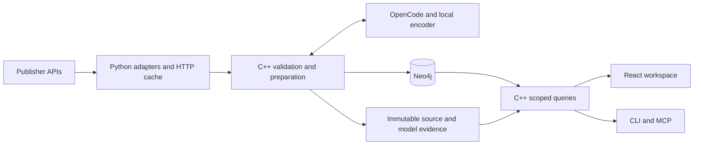

# Axthena

### Evidence-backed company research, from source articles to an interactive graph.

Axthena collects company reporting, extracts structured information and connects
organisations, activities, ideas, events and claims in Neo4j. Ask a question,
narrow the result and inspect the exact passages behind it.

**C++20 · Python · Neo4j · React · TypeScript · Cytoscape.js · ECharts**

[Portfolio](docs/portfolio.md) · [Workspace](docs/workspace.md) ·
[Ingestion](docs/ingestion.md) · [Benchmarking](docs/benchmarking.md) ·
[V2 roadmap](docs/roadmap.md) · [CV](docs/cv.md)


## Capabilities

- **Ask and follow up:** natural-language questions select validated, scoped queries.
- **Compare companies:** inspect distinct-report activity counts and shared coverage.
- **Explore connections:** fullscreen graphs, continuous forces, pins, layers and paths.
- **Audit claims:** open exact source passages and inspect confirmation qualifications.
- **Automate collection:** configurable adapters, caching, retries, scheduling and resume.
- **Reproduce results:** pinned runs, retained model responses and verified backup/restore.

## Try the visual demo

With Node 24 LTS, from the repository root:

```sh
git clone https://github.com/zenpuddah/axthena.git
cd axthena
./workspace/npmw ci
./workspace/npmw run build
./workspace/npmw run preview
```

Open **http://127.0.0.1:4173/?demo=1**. Checked-in frozen results support graph,
comparison and source inspection without a database or model account. Live chat
requires the connected application. The demo includes source excerpts and metadata,
not the original acquisition archive or complete article bodies.

## Architecture



Python owns acquisition mechanics. C++ owns identity, semantic validation and
publication. Neo4j serves application reads; the UI renders scoped results.
Model-generated plans pass validation before execution. Runtime prompts in
`prompts/` are versioned application inputs.

## Build the full application

Tested on **macOS arm64**, Apple Clang 21, CMake 4.4.3 and libcurl 8.7.1.
SHA-256 currently uses macOS CommonCrypto. Python 3.9+, CMake 3.24+, a C++20 compiler,
libcurl and SQLite development libraries are required. SQLite is used for read-only
legacy migration; Neo4j is the active database. CLion can open `CMakeLists.txt`.

```sh
python3 -B tools/bootstrap_model.py
python3 -B tools/neo4j_runtime.py start
cmake --preset axthena-dev
cmake --build --preset axthena-dev
ctest --preset axthena-dev --output-on-failure
```

Bootstrap downloads the pinned Nomic Embed Text v1.5 F16 encoder. CMake fetches
hash-pinned JSON, HTTP and encoder dependencies. The runtime helper provisions
Neo4j Community 5.26.31 and JDK 21 under ignored `artifacts/`.

Before live preparation, configure provider access in OpenCode (tested with 2.0.30)
and select an available provider/model in the processing configuration. Credentials
remain in OpenCode. Review source/date/volume settings before collecting:

```sh
./axthena ingest --config config/ingestion-annual-2025.json --dry-run
./axthena ingest --config config/ingestion-annual-2025.json
./axthena verify
./axthena query --request examples/query-annual.json
./workspace/npmw ci
./workspace/npmw run build
./axthena serve --assets workspace/dist
```

Open **http://127.0.0.1:17780**. Preparation makes model calls; a new run is not
promised to reproduce the historical demonstration. The live archive and database
are not included in this repository. See [ingestion](docs/ingestion.md) for once,
watch, resume, cache and version semantics.

## Demonstrated results

The development demonstration sampled **48 reports** from NVIDIA Blog and Microsoft
Cloud Blog across 2025, up to two per publisher/month.

| Result | Recorded scope |
|---|---|
| Structured corpus | 181 organisations, 99 events, 92 Ideas, 794 exact passages |
| Domain matching | 235 labels → 222 categories; thirteen retained model-selected reuses |
| Processing | 43 complete, 4 partial, 1 insufficient-information report |
| Checks | 205 native checks + 17 Python tests across eight CTest groups; five frontend tests |
| Preservation | Exact replay, independent restore and 3,014 original-file hashes preserved |

These are bounded engineering results, not a semantic-accuracy score or production
SLA. The frozen visual demo uses the pre-domain annual baseline. Exact-version first
availability is unknown for the sample: strict historical reads exclude it, while
declared-date exploration is explicitly retrospective. First-party announcements
do not independently establish business outcomes or stock-price effects.

## Documentation

- [Workspace and query interfaces](docs/workspace.md)
- [Configurable ingestion](docs/ingestion.md)
- [Portfolio case study](docs/portfolio.md) and [CV wording](docs/cv.md)
- [Benchmark evidence and protocol](docs/benchmarking.md)
- [V2 starting point and roadmap](docs/roadmap.md)
- [Major development milestones](docs/history.md)

## Backup, restore and database inspection

```sh
./axthena backup --out artifacts/backups/review-1
./axthena restore --source artifacts/backups/review-1 --store artifacts/restored-review-1
./axthena verify --store artifacts/restored-review-1
```

Use fresh destinations. Each store identifies a separate Neo4j namespace; published
runs and original evidence remain immutable. Operations on one store are sequential.

Neo4j Browser: **http://127.0.0.1:17474/browser/**. Connect to
`bolt://127.0.0.1:17687`, username/database `neo4j`, using the locally generated
password in `artifacts/neo4j/password`. `examples/neo4j-browser.cypher` contains
scoped inspection queries; direct Cypher does not apply application read policies.

Legacy `import` without `--input` requires retained pilot captures plus review JSON
under `artifacts/pilot/review/`; those historical files are not distributed here.
Normal ingestion does not require them. `import --input FILE` accepts an existing
import envelope whose evidence has already been retained in the selected store.
