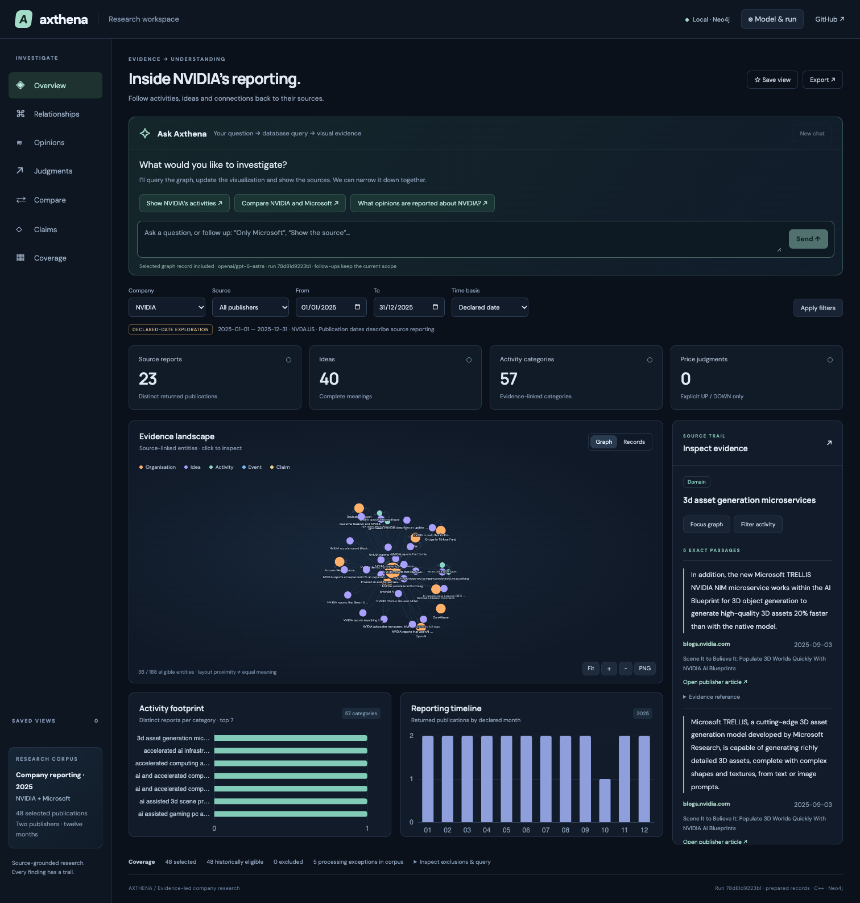

# Axthena — evidence-backed research platform

[Demo](workspace.md) · [Benchmarking](benchmarking.md) · [Roadmap](roadmap.md)

## Problem

Company reporting is scattered across articles. A useful research answer must
connect entities and statements without losing who said what, when, or which
passage supports the interpretation.

## Solution

Axthena combines configurable source collection, structured AI extraction, a
native C++/Neo4j backend and an interactive conversational graph. A researcher can
ask a question, narrow the result, compare companies and inspect exact source text.

## Engineering decisions

| Decision | Reason |
|---|---|
| C++ owns validation, identity, publication and queries | One semantic boundary across CLI, HTTP and MCP |
| Python adapters with standard-library HTTP/cache/job orchestration | Reusable ingestion without giving adapters database ownership |
| Neo4j plus immutable evidence files | Connected reads with retained source/model provenance |
| Name/vector candidate union and validated SAME-only reuse | Separate retrieval similarity from semantic equivalence |
| Validated structured chat intents | Query-driven interaction with explicit scope and evidence |
| Versioned attempts, immutable runs and independent restore | Review failures and reproduce accepted outputs without overwrites |
| Persistent Cytoscape renderer and live simulation | Adjust graph controls without repeatedly rebuilding the scene/camera |

## Demonstrated scale

The 2025 two-publisher demonstration selected 48 reports: 43 complete, four partial
and one insufficient-information result. It produced 181 organisations, 99 events,
92 Ideas and 794 exact passages. A subsequent domain pass reduced 235 labels to
222 categories through thirteen retained reuses.

Development verification covered 205 native checks, 17 Python ingestion tests and
five frontend tests, plus HTTP/MCP and browser checks. Exact replay preserved
3,014 original-file hashes; backup/restore was independently checked. The public
repository includes tests and frozen visual results, not the original live archive.

These are structural/engineering results, not representative extraction accuracy.
The [benchmark guide](benchmarking.md) distinguishes recorded timings from future
performance and semantic evaluation.

## Three-minute presentation

1. Open the frozen demo or prepared live workspace.
2. Explore NVIDIA, then compare Microsoft and inspect shared report counts.
3. Select an activity, follow a displayed path and open its source passage.
4. Switch to strict history to explain why unknown first availability is excluded.
5. With live chat, ask a follow-up and reopen a previous answer's exact evidence.

## Remaining work

The [V2 roadmap](roadmap.md) proposes paired-period views, decision inspection and
ingestion-status UI after baseline measurement and semantic review. Market-session
alignment, recoverable compression, broader semantic evaluation and representative
scale acceptance remain open. The project does not establish trading performance
or predictive accuracy.
