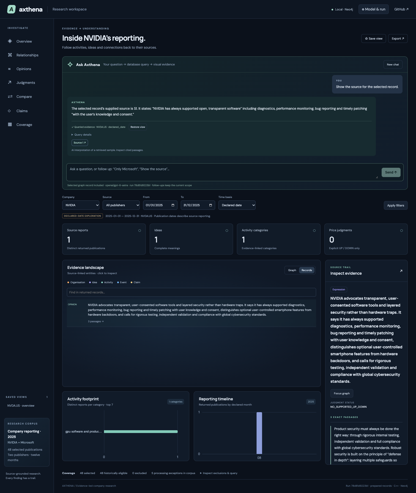
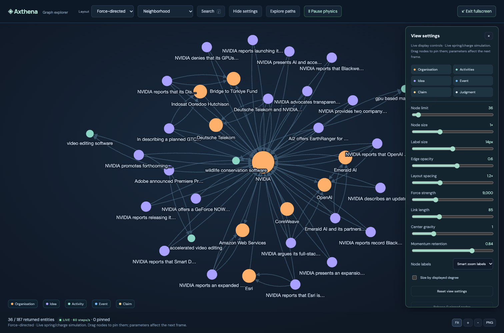

# Ask Axthena

Ask a question, execute a scoped query, explore the result and inspect its sources.



## Frozen visual demo

```sh
./workspace/npmw ci
./workspace/npmw run build
./workspace/npmw run preview
```

Open **http://127.0.0.1:4173/?demo=1**. Graph, records, comparison and source inspection
use checked-in frozen NVIDIA/Microsoft snapshots. AI chat requires a live service.
Node 24 LTS is recommended; `npmw` uses local tooling if present, otherwise system npm.

## Run locally

Build and prepare a store using the [README](../README.md) and [ingestion guide](ingestion.md), then:

```sh
./workspace/npmw run build
./axthena serve --assets workspace/dist
```

Open **http://127.0.0.1:17780**. Use `--store DIR` for a different store. Configure
provider access in OpenCode; **Model & run** selects the provider/model and published
run. Credentials are not copied into the browser. The store is sequential: prepare
before serving, or serve a separately restored snapshot while preparing another.

## Demonstration

1. Ask **“What opinions are reported about NVIDIA?”**
2. Follow up **“Now only Microsoft, keeping the same information type and dates.”**
3. Open a **Source** link; its original scoped result and exact passages are restored.
4. Ask **“Compare NVIDIA and Microsoft.”** Inspect distinct-report counts and shared IDs.
5. Filter by activity or publication month; save a view or export JSON/graph PNG.
6. Switch to **Strict availability**. The frozen 2025 corpus is excluded because its
   exact-version first availability is unknown; declared-date mode is retrospective.

## Graph controls

- Fullscreen, Escape to exit, explicit Fit and persistent zoom/pan.
- Search with `/` or Ctrl/Cmd+K while the graph has focus; reveal matching neighborhoods.
- Force-directed, radial, hierarchical, circle and grid layouts.
- Live force, link length, gravity, damping, node/label size and edge-opacity controls.
- Pause/resume physics, drag to pin, unpin, hover neighbors and entity layers.
- Displayed shortest paths between two visible nodes, with explicit no-path results.
- Default focused neighborhood and up to 500 displayed nodes using **All returned**.



Layout geometry and displayed undirected paths do not establish semantic equivalence
or business causality. Display caps are separate from query truncation. Physics pauses
when hidden; reduced-motion preferences start it paused and disable layout animation.

## Queries and AI boundaries

| Read | Purpose |
|---|---|
| Q1 | Stock-scoped expressions/events, opinions and qualified price judgments |
| Q2 | Bounded organisation neighborhood and supported relevance paths |
| Q3 | Source expressions supporting an Idea |
| Q4 | Evidence concerning either of two stocks |
| Q5 | Claims, scoped confirmations, holds and dated reviews |
| Q6 | Exact evidence and processing trace for a record |
| Q7 | Coverage, processing gaps and source exclusions |

Chat chooses validated intents; it does not execute arbitrary model-generated Cypher.
Manual controls and HTTP/MCP use the same C++ query catalogue. Summaries are bounded
to retrieved records, and citation membership is checked. Membership does not prove
that every generated interpretation is correct. Partial/truncated results remain labelled.

```sh
./axthena query --request examples/query-annual.json
./axthena investigate --request examples/investigate-nvidia.json
./axthena mcp
```

MCP exposes `catalog` and `investigate` over newline-delimited JSON-RPC, protocol
`2025-11-25`. `--run ID` pins a publication; `--store DIR` selects its namespace.

## Retained investigation recipes

[`examples/investigation-workflows.json`](../examples/investigation-workflows.json)
contains company, period, opinion, claim, relationship and strict-history cases.
It pins the historical domain-resolved run, which is not distributed as a live store.
To use your own run, copy the pack and replace its run and any run-specific record IDs.

```sh
python3 scripts/run-investigation-workflows.py --help
```

The runner retains requests, responses and hashes in a fresh output directory. It
measures repeatability, not latency. [`scripts/export-workspace-demo.py`](../scripts/export-workspace-demo.py)
can regenerate frozen snapshots from a local service, preserving excerpts/metadata
and a digest manifest while omitting full article bodies and acquisition headers.
